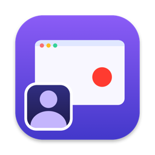

# Recorder

A small native macOS screen recorder. Pick a window or an app with the system picker and record it with a rounded-square webcam bubble baked into the video. Recordings are saved as `.mp4` to `~/Movies/Recordings/`.



## Features

- System window/app picker (ScreenCaptureKit)
- Mirrored rounded-square camera bubble, composited into every frame
- Bubble corner and size (small / medium / large)
- Microphone audio, plus optional audio from the captured app as a second track
- 3-2-1 countdown, Dock window and menu-bar controls
- Recordings stay playable up to the last 2 seconds if the app quits mid-recording
- YouTube-ready output: H.264 High profile, up to 1080p at 30 fps, ~8 Mbps at 1080p (about 3.6 GB per hour), BT.709 color, AAC audio at 48 kHz

## Requirements

- macOS 15 or later
- Xcode 16 or later (Swift 6 toolchain)

## Build

```sh
./build.sh           # builds build/Recorder.app
./build.sh install   # also copies it to /Applications
swift test           # runs the tests
```

The app is ad-hoc signed, so macOS may ask for camera and microphone permission again after a rebuild.

## Usage

1. Open Recorder and click **Start Recording…**
2. Choose a window or app in the picker. Recording starts after the countdown.
3. Click **Stop Recording**. The file is revealed in Finder.

## License

MIT
